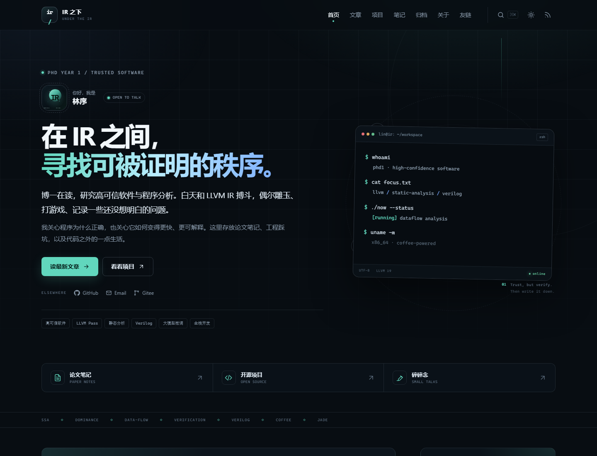
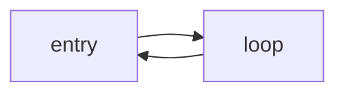

# IR 之下 · 个人博客

一个用 **Django 6** 手写的中文个人博客：技术为主、生活为辅，包含文章、项目、双向链接知识库、归档、搜索、RSS、深色模式和极客风响应式界面。

> Slogan：代码、逻辑与细碎日常。<br>
> 演示身份：林序，博一，高可信软件 / LLVM / 静态分析。**页面里的人设、邮箱和社交链接是演示内容，请替换成你自己的。**



## 已实现的功能

| 模块 | 内容 |
| --- | --- |
| 首页 | Hero、终端自我介绍、快捷入口、最近 6 篇文章、精选项目、NOW 动态、侧栏、RSS 卡片 |
| 文章 | 五大分类、双标签、卡片/清单视图、自动目录、上一篇/下一篇、相关推荐、阅读进度、Giscus 接口 |
| Markdown | Pygments 代码高亮（C++ / Verilog / LLVM IR / Python…）、行号、复制按钮、KaTeX 公式、Mermaid 图 |
| 项目 | 分类筛选、WIP 分区、完成度、技术栈、封面、详情页、仓库/演示链接 |
| 知识库 | Zettelkasten 卡片、`[[双链]]` 解析、反向链接/出链、标签和类型筛选 |
| 归档 | 按年份/月份时间线、分类汇总、标签云 |
| 关于 | 研究、技术栈、路线图、爱好、本站说明、联系方式 |
| 其他 | 友链、书单、工具箱、在线简历、404 页面 |
| 检索 | 顶栏 `Ctrl/Cmd + K` 即时搜索 + 独立搜索页（文章 / 卡片 / 项目） |
| 订阅 | RSS 2.0、Sitemap、robots.txt |
| 主题 | 深色/浅色切换、`localStorage` 记忆、系统主题色同步 |
| 统计 | 去标识化的每日访客计数（IP + UA 的加盐哈希，只保留每日一条） |
| 后台 | Django Admin：文章、项目、知识卡片、动态、书单、友链、工具、访问统计 |

## 快速启动

要求：Python 3.12+。

```powershell
# Windows PowerShell
.\run.ps1
```

`run.ps1` 会检查 Django 是否已安装，缺失时先执行 `pip install -r requirements.txt`；如果 `db.sqlite3` 不存在，还会自动迁移并填充演示内容。

也可以手动：

```powershell
python -m pip install -r requirements.txt
python manage.py migrate
python manage.py seed_demo --with-admin
python manage.py runserver 127.0.0.1:8000
```

打开 <http://127.0.0.1:8000/>。

> 当前开发工作区为了离线运行保留了 `vendor/`，但它默认不进入 Git 仓库。从 GitHub clone 后请使用上面的依赖安装步骤，`run.ps1` / `run.sh` 已包含自动检测。

### 演示后台

- 地址：<http://127.0.0.1:8000/admin/>
- 用户名：`admin`
- 密码：首次执行 `seed_demo --with-admin` 时**随机生成并打印在终端**；也可以用环境变量 `BLOG_ADMIN_PASSWORD` 指定。

如果已经有数据库但忘记了密码：

```powershell
python manage.py changepassword admin
```

> **部署前必须修改密码**。仓库不包含 `db.sqlite3`、`.env` 或任何真实凭据。

如果部署到公网，建议重新创建管理员：

```powershell
python manage.py createsuperuser
```

### 如果不想用 vendor

```powershell
python -m pip install -r requirements.txt
```

当前工作区的 `vendor/` 是可选的离线依赖目录；它被 `.gitignore` 排除，不会上传到 GitHub。`requirements.txt` 已固定版本。

## 个性化：先改这 3 个地方

1. **站点人设 / 社交链接**：`blog/site_config.py`
   - 昵称、slogan、简介、邮箱、GitHub、Gitee、技术栈、关于页时间线。
2. **头像和项目封面**：`static/img/avatar.svg`、`static/img/projects/*.svg`
   - 都是本地 SVG，不依赖图床；可以直接换成自己的图片。
3. **演示文章和项目**：后台编辑，或者改 `blog/demo_content.py`、`blog/demo_posts_more.py`、`blog/demo_assets.py` 后重新运行：

```powershell
python manage.py seed_demo
```

`seed_demo` 以 slug / 标题为键做 `update_or_create`，重复运行不会产生重复数据。

## 写一篇新文章

后台 → 文章 → 增加文章。正文使用 Markdown：

````markdown
## 一个二级标题

行内公式 $x^2 + y^2 = z^2$，块公式：

$$
\mathrm{Dom}(n) = \{n\} \cup \bigcap_{p \in pred(n)} \mathrm{Dom}(p)
$$

```cpp
int main() { return 0; }
```



相关卡片：[[SSA]]、[[支配边界|支配边界是什么]]。
````

- 目录、阅读时长、代码行号、复制按钮会自动生成；
- 更新时间、更新日志、勘误区在后台同一页填写；
- 发布状态为“已发布”且发布时间不晚于当前时间才会出现在前台；
- 分类和标签在后台管理，标签支持颜色。

## 知识库双链

卡片正文中写 `[[SSA]]` 或 `[[SSA|静态单赋值]]`：

- 标题、slug、别名都能被解析；
- 详情页底部自动展示 **反向链接（Linked From）** 和 **出链（References）**；
- 未创建的链接会显示为删除线，提示“尚未创建”；
- 支持 `[[SSA#定义]]` 形式的锚点。

## 配置项

复制 `.env.example` 为 `.env`，或者直接设置环境变量：

| 变量 | 默认值 | 说明 |
| --- | --- | --- |
| `BLOG_SECRET_KEY` | 开发用占位串 | 生产必须替换 |
| `BLOG_DEBUG` | `1` | 生产设为 `0` |
| `BLOG_ALLOWED_HOSTS` | `127.0.0.1,localhost,[::1],testserver` | 逗号分隔 |
| `BLOG_SITE_URL` | `http://127.0.0.1:8000` | canonical / RSS / Sitemap 的绝对地址 |
| `BLOG_CSRF_TRUSTED_ORIGINS` | 空 | HTTPS 域名，逗号分隔 |
| `BLOG_SECURE_COOKIES` | 非 DEBUG 时 `1` | HTTPS 下设置 Secure Cookie |
| `BLOG_SSL_REDIRECT` | `0` | 由 Django 强制跳转 HTTPS；确认反代已处理时再开启 |
| `BLOG_HSTS_SECONDS` | `0` | HSTS 时长；确认全站 HTTPS 后再设置 |
| `BLOG_DEMO_MODE` | `1` | 仅用于演示文案开关 |
| `BLOG_GISCUS_REPO` | 空 | 例如 `user/repo` |
| `BLOG_GISCUS_REPO_ID` | 空 | giscus.app 生成 |
| `BLOG_GISCUS_CATEGORY` | `Announcements` | 讨论分类 |
| `BLOG_GISCUS_CATEGORY_ID` | 空 | 分类 ID |

配置了 `BLOG_GISCUS_REPO` 和 `BLOG_GISCUS_REPO_ID` 后，文章底部自动加载 Giscus；未配置时显示一个轻量的邮件讨论占位。

## 部署

### 方式 A：Gunicorn + Nginx（Linux，推荐）

```bash
python -m venv .venv
source .venv/bin/activate
pip install -r requirements.txt gunicorn
export BLOG_DEBUG=0
export BLOG_SECRET_KEY='a-long-random-string'
export BLOG_ALLOWED_HOSTS='blog.example.com'
export BLOG_SITE_URL='https://blog.example.com'
python manage.py migrate
python manage.py collectstatic --noinput
gunicorn config.wsgi:application --bind 127.0.0.1:8000 --workers 3
```

Nginx 反向代理到 `127.0.0.1:8000`，并把 `/static/` 指向 `staticfiles/`。

### 方式 B：Waitress（Windows / 单机）

```powershell
pip install waitress
waitress-serve --listen=127.0.0.1:8000 config.wsgi:application
```

### 上线检查

- [ ] `BLOG_DEBUG=0`
- [ ] 更换 `BLOG_SECRET_KEY`
- [ ] 设置 `BLOG_ALLOWED_HOSTS`、`BLOG_SITE_URL`
- [ ] 修改/删除演示管理员密码
- [ ] 执行 `collectstatic`
- [ ] 定期备份 `db.sqlite3`（以及未来可能使用的 `media/`）
- [ ] 配置 HTTPS 后再开启 `BLOG_SECURE_COOKIES=1`
- [ ] 确认全站 HTTPS 后，按需设置 `BLOG_SSL_REDIRECT=1` 与 `BLOG_HSTS_SECONDS`

SQLite 对小站足够；如果文章量或并发明显增长，可以在 `config/settings.py` 切换 PostgreSQL，Django ORM 代码无需改动。

## 目录结构

```text
Myblogs/
├── manage.py
├── config/                 # settings / urls / wsgi / asgi
├── blog/
│   ├── models.py           # 文章、分类、标签、项目、卡片、动态、访客…
│   ├── views.py            # 页面与 JSON 搜索 API
│   ├── markdown_renderer.py# 代码、公式、Mermaid、双链、目录
│   ├── services.py         # 侧栏、归档、双链索引
│   ├── middleware.py       # 轻量访客统计
│   ├── admin.py
│   ├── management/commands/seed_demo.py
│   ├── demo_*.py           # 演示内容
│   └── tests.py
├── templates/              # 服务端模板，无前端框架
├── static/
│   ├── css/main.css        # 手写样式
│   ├── js/main.js          # 主题、搜索、代码复制、TOC、Mermaid…
│   └── img/                # 本地 SVG 头像、封面、favicon
├── docs/                   # 预览截图
├── vendor/                 # 可选，离线依赖
├── requirements.txt
├── run.ps1 / run.sh
└── .env.example
```

## 验证

```powershell
python manage.py check
python manage.py test
```

当前测试覆盖：页面路由、Markdown / TOC / 代码 / 公式渲染、双链反向链接、搜索页与 API、RSS、Sitemap、未来文章隐藏、访客去重、404。

## 说明与取舍

- **没有使用前端框架**：页面是 Django 模板 + 手写 CSS + 原生 JS，构建链为零，部署简单。
- **Math / Mermaid 走 CDN**：KaTeX 与 Mermaid 从 jsDelivr 加载；如果部署环境要求完全离线，可把对应资源下载到 `static/vendor/` 并改模板中的 URL。
- **搜索是 SQLite `LIKE`**：对个人站足够，没有引入 Elasticsearch。文章量很大时可以换 SQLite FTS5 或 Postgres 全文索引。
- **没有图片上传**：当前封面使用本地 SVG；需要上传文章配图时，可给 `Post` 增加 `ImageField` 并配置 `MEDIA_ROOT`（需要 Pillow）。
- **阅读量按 session 去重**：同一浏览器会话内刷新不会重复计数；后台可查看。
- **演示内容**：文章、项目、书单、友链均为演示数据，不代表真实经历或成果；发布前请全部替换。

## License

- 站点代码：MIT
- 文章与图片：CC BY-NC-SA 4.0（除非特别注明）

---

Built with Django, Markdown, Pygments, and a lot of coffee.
